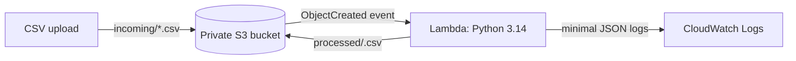

# Serverless CSV Processing Pipeline

A small, event-driven AWS portfolio project that validates incoming sales CSV files, removes duplicate rows, calculates exact decimal revenue, and writes a cleaned CSV to a separate S3 prefix. It also includes an optional local UI and Vercel hosting adapter for demonstrating the processor in a browser.

> **Deployment is optional and not performed by this project setup.** AWS usage can incur charges. Check your account plan, remaining credits, region-specific rates, and the change set before deployment. If zero charges are a strict requirement and coverage cannot be confirmed, use the local tests only.

## Problem and solution

Manually cleaning uploaded sales files is repetitive and error-prone. This pipeline uses S3 object-created notifications to run a Python Lambda function only when a `.csv` arrives under `incoming/`. It validates the whole file, removes duplicates using normalized product, quantity, and price, computes `Decimal` revenue, and writes a UTF-8 result under `processed/`.

The function returns a JSON summary with status, source/output key, unique rows processed, duplicates removed, and total revenue. Invalid files are clearly marked `rejected`; no partial cleaned file is written. Transient AWS failures are logged without file contents and raised to allow Lambda retry.

## Architecture



The suffix and prefix filter prevents output writes from triggering the function. Lambda checks the prefix and suffix again. See [architecture.md](docs/architecture.md) for details.

## Features

- UTF-8 and UTF-8 BOM input; required `product`, `quantity`, and `unit_price` columns.
- Rejects malformed CSV, invalid/negative numbers, empty products, empty files, files over 5 MiB, files over 25,000 rows, and prices outside a bounded decimal range.
- Decimal arithmetic (no binary floating-point revenue math).
- Deduplication by trimmed/case-folded product, integer quantity, and numeric price.
- Conditional writes to a deterministic output key based on source identity and bytes; repeated delivery cannot overwrite an existing result.
- Private, SSE-S3 encrypted bucket; object-level least-privilege role; seven-day CloudWatch log retention.
- The AWS Lambda processor uses the Python standard library and Lambda-provided AWS SDK. The optional Vercel adapter uses FastAPI.

## Technology

Python 3.14 on AWS Lambda and Vercel Functions, FastAPI, Amazon S3, IAM, CloudWatch Logs, AWS SAM/CloudFormation, pytest, Git.

## Repository layout

```text
src/lambda_function.py         CSV processor and S3 Lambda handler
app.py                         FastAPI endpoint for Vercel-hosted UI
local_ui.py                    Optional localhost-only browser demo server
public/                        Browser assets served locally and by Vercel CDN
.python-version                Vercel Python runtime selection (3.14)
vercel.json                    Vercel security response headers
tests/test_processor.py        CSV rules, validation, Decimal/deduplication
tests/test_lambda_handler.py   event, S3 error, idempotency, naming tests
tests/test_vercel_app.py       FastAPI processing and upload-limit checks
tests/test_local_ui.py         UI-to-processor integration checks
sample-data/sales.csv          small sample input
docs/architecture.md           flow and design choices
docs/deployment.md             Console and SAM deployment/cleanup
docs/security.md               least-privilege decisions
docs/cost-management.md        account eligibility, cost controls, teardown
docs/local-ui.md               local browser UI
docs/vercel-deployment.md      optional Vercel hosting instructions
template.yaml                  SAM resources and event filter
requirements.txt               FastAPI runtime dependency for Vercel
requirements-dev.txt           FastAPI test client and pytest
```

## Local setup and tests

Python 3.10+ can run the source and tests locally; the deployed Lambda uses the currently supported managed runtime configured in `template.yaml`.

```powershell
py -m venv .venv
.\.venv\Scripts\Activate.ps1
python -m pip install -r requirements-dev.txt
python -m pytest -q
```

These are local commands only. They do not access AWS or incur AWS charges. The project uses the AWS SDK (`boto3`) provided by the Lambda runtime; tests inject a fake S3 client.

## Local browser UI

Run `python local_ui.py` from the project directory, then open <http://127.0.0.1:8000>. Choose or drop a CSV file to see validation results and download the cleaned output. The UI uses the same Python processor, binds only to localhost, and does not connect to AWS or send the file to a remote service. Stop it with `Ctrl+C`. See [local-ui.md](docs/local-ui.md).

## Optional Vercel hosting

The Vercel adapter hosts the UI and a small FastAPI processing endpoint; it does not deploy or connect the AWS S3/Lambda pipeline. When hosted, CSV contents are sent to Vercel for processing. The application does not intentionally persist the files, but do not upload confidential or personal data. The hosted endpoint caps uploads at 4 MiB; the AWS/local processor uses the 5 MiB limit. Review [vercel-deployment.md](docs/vercel-deployment.md) and Vercel’s current plan limits before enabling public hosting.

## Input and output example

`sample-data/sales.csv`:

```csv
product,quantity,unit_price
Notebook,3,2.50
Pen,10,0.75
Notebook,3,2.50
```

Expected cleaned CSV content:

```csv
product,quantity,unit_price,revenue
Notebook,3,2.50,7.50
Pen,10,0.75,7.50
```

Expected summary fields for this file: `status=success`, `rows_processed=2`, `duplicates_removed=1`, `total_revenue=15.00`. The actual output S3 key is `processed/<sha256-digest>.csv`. A replay returns `status=duplicate` and zero work for that invocation; it does not rewrite the object.

## AWS deployment

Two optional paths are documented in [deployment.md](docs/deployment.md):

- **Path A:** create the resources through the AWS Management Console.
- **Path B:** use AWS SAM for repeatable deployment.

Both create one bucket, one Lambda function/role, a CloudWatch log group, and S3 notification/policy configuration. They are alternatives; do not deploy both into the same environment. The SAM change set must be reviewed and explicitly approved by you before it is applied. This repository does not deploy anything automatically and no AWS deployment has been run.

## Security

The function's role can read only `incoming/*`, write only `processed/*`, and write logs to its own log group. It cannot list or delete objects, read processed objects, or administer AWS. The person deploying needs separate resource-creation and role-passing permissions. Never commit credentials or upload private customer data. Review [security.md](docs/security.md).

## Costs

This is not represented as zero-cost. Lambda requests/compute, S3 requests/storage, and CloudWatch log ingestion/storage can incur charges; eligibility depends on account plan, credits, region, and usage. The current account is unknown, so its free allowance cannot be confirmed here. See [cost-management.md](docs/cost-management.md) for official pricing references, a pre-deploy eligibility checklist, and full teardown verification.

## Troubleshooting

- `rejected`: correct CSV headers, encoding, field count, names, quantity, or price; the whole input is rejected, not partially processed.
- `AccessDenied`: check only the specific S3 object permissions, Lambda invoke permission, and log-group write permissions; do not grant admin/full-access policies.
- No invocation: ensure the object is in the same-region bucket, key begins `incoming/`, and name ends in `.csv`.
- No output after a transient error: inspect CloudWatch and Lambda asynchronous retry status; do not assume S3 invokes exactly once.
- SAM deployment fails: validate the template, verify bucket-name uniqueness and current SAM/runtime support, and inspect the reviewed change set.

## Limitations and future improvements

The implementation reads a bounded object into memory (maximum 5 MiB), rejects the entire file if any row is invalid, and does not maintain a durable audit record or dead-letter queue. Output objects are retained until manually deleted. For a production workload, consider carefully scoped alerting, a quarantine workflow, stronger event/retry observability, schema/versioning policy, and explicit retention—but assess costs and privacy requirements first.

## GitHub portfolio setup

1. Create a new empty GitHub repository named `cloud-csv-processing-pipeline`. Do not add a generated README/license if keeping this local copy.
2. Review the files, run the tests, and ensure no credentials, account identifiers, private records, or deployment artifacts are staged.
3. Initialize and push from the project folder:

   ```powershell
   git init
   git add .
   git status
   git commit -m "Build serverless CSV processing pipeline"
   git branch -M main
   git remote add origin https://github.com/<YOUR-USER>/cloud-csv-processing-pipeline.git
   git push -u origin main
   ```

   Git commands are local except `git push`, which publishes the repository. Choose GitHub authentication without storing a token in source files.

Suggested follow-up commit messages:

- `Add CSV validation and Decimal revenue calculation`
- `Add idempotent S3-triggered Lambda handler`
- `Add least-privilege SAM infrastructure`
- `Document deployment, security, and cost controls`

## License

MIT; see [LICENSE](LICENSE).
