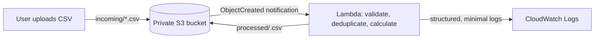

# Architecture

## Request flow

The bucket notification only matches the `incoming/` prefix and `.csv` suffix. The function independently checks both conditions, and writes only to `processed/`, avoiding self-trigger loops.

## Components

- **S3** stores the source and result in distinct prefixes in one private bucket. S3-managed AES-256 encryption is enabled; public ACLs and policies are blocked.
- **S3 event notifications** start the function when an object is created under `incoming/` with a `.csv` suffix. Notifications are at-least-once, so duplicate delivery is expected.
- **Lambda** streams at most 5 MiB and accepts at most 25,000 data rows, validates the file, and produces a UTF-8 CSV. Prices are restricted to a decimal exponent/magnitude of at most 100 to keep output and arithmetic bounded. It is configured for 128 MiB, 15 seconds, and at most two concurrent executions for this demo.
- **IAM execution role** grants the function only `GetObject` on `incoming/*`, `PutObject` on `processed/*`, and log-stream write permissions for its pre-created log group.
- **CloudWatch Logs** retains the function log group for seven days. Logs contain status, counts, output key, or an error category, not CSV contents or source object keys.

## Validation and duplicate behavior

Headers are trimmed and case-folded when matched. Products are trimmed for output and case-folded for deduplication. Quantities must be non-negative base-10 integers; prices must be finite, non-negative `Decimal` values. A malformed row rejects the entire file; no partial output is written.

The output key is a SHA-256 digest of the bucket, source key, S3 version ID (when present) or ETag, and the downloaded source bytes. `IfNoneMatch: *` makes creation conditional: a replay cannot overwrite an existing result. A repeated delivery reports `duplicate` and zero work for that invocation. Changed content yields a new output key rather than replacing an older result.

S3 notifications do not provide exactly-once delivery. A failed S3 operation is logged without payload details and raised so Lambda's asynchronous retry policy can apply. Repeated output writes remain safe. Invalid input is reported as `rejected` and is not retried; the original object remains in `incoming/` for diagnosis or removal by its owner.

## Optional browser hosting

The browser UI can be hosted separately on Vercel: static assets in `public/` are served from Vercel's CDN, and a Python 3.14 FastAPI function in `app.py` reuses `transform_csv` for `/api/process`. Hosted uploads go to Vercel, not to the AWS bucket; the browser warns users and the function does not intentionally persist the CSV. The Vercel app does not invoke or replace the AWS S3/Lambda event pipeline. See [vercel-deployment.md](vercel-deployment.md).
